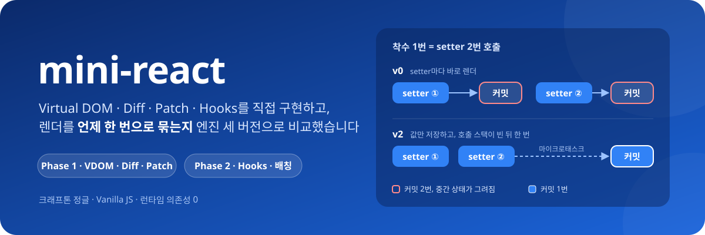
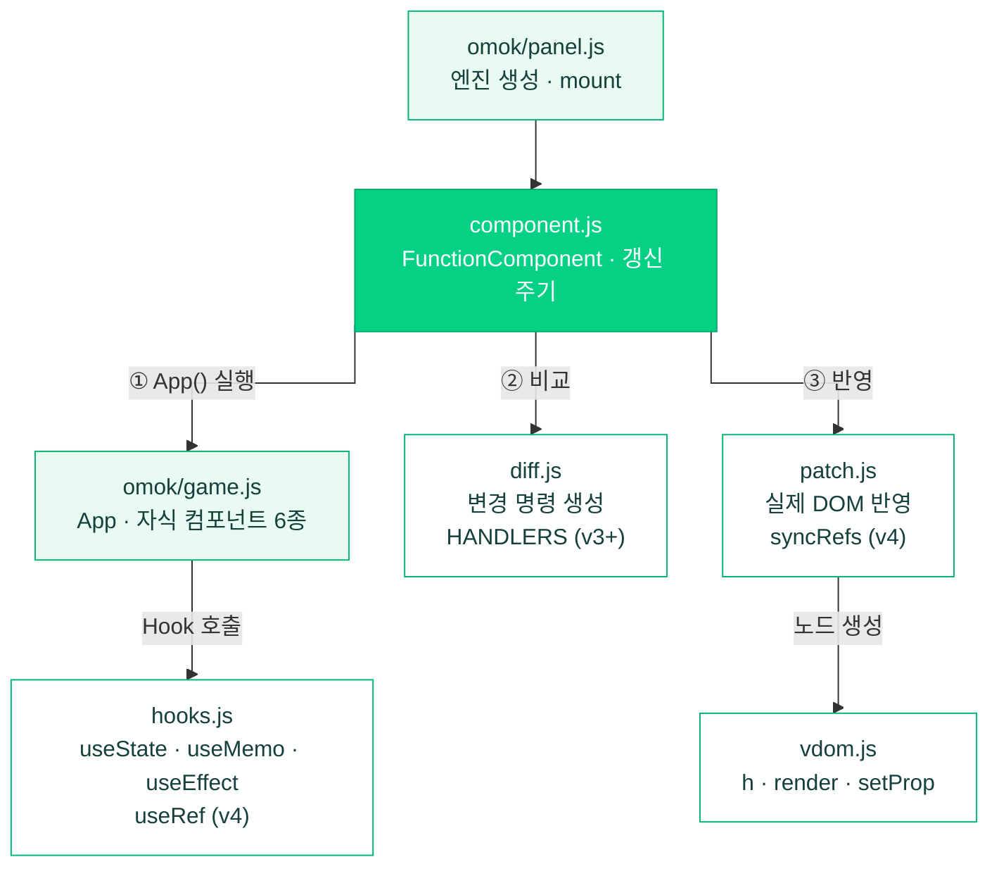
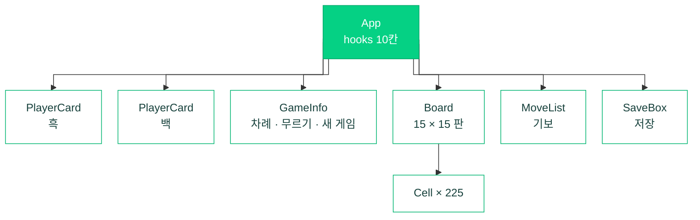
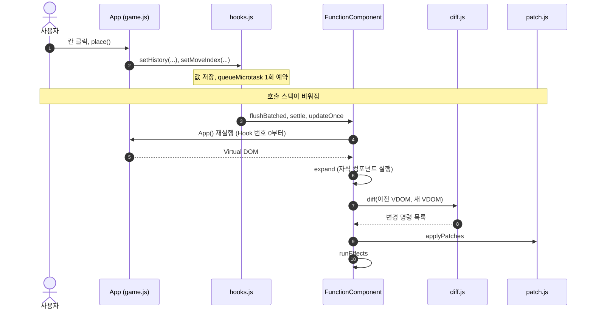
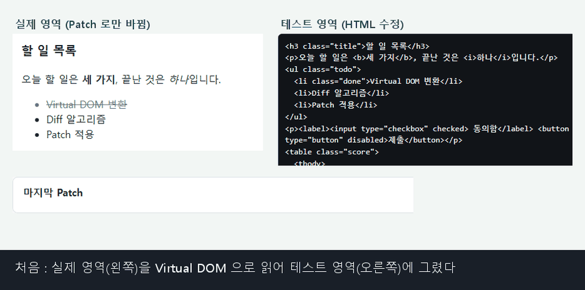
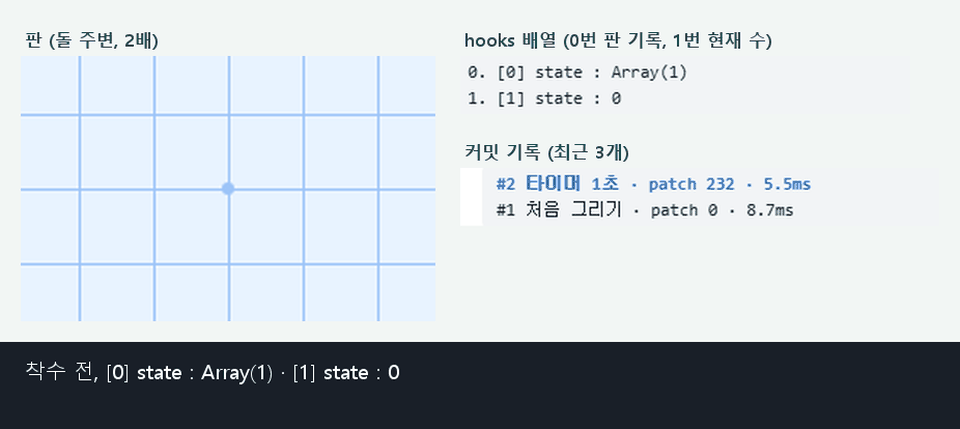
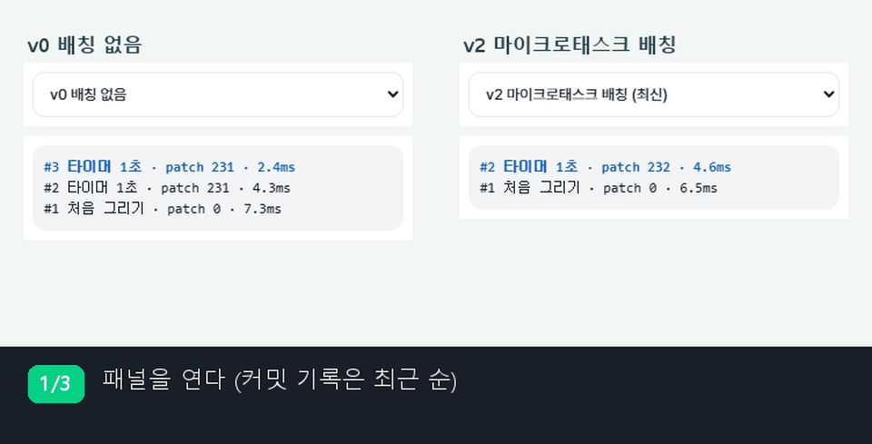

<div align="center">



<br>

**"React의 핵심을 직접 만들고, 같은 앱을 엔진만 바꿔 가며 렌더 시점과 핸들러 처리를 비교했습니다"**

<p>
  
  
  
  
</p>

<sub>크래프톤 정글 · 미니 React 구현 과제</sub><br>
<sub>엔진과 데모는 Vanilla JavaScript로 작성했으며 빌드 도구와 런타임 라이브러리를 사용하지 않습니다. 개발 의존성은 테스트용 <code>jsdom</code> 하나입니다.</sub>

[구성](#-두-단계-구성) · [아키텍처](#-아키텍처) · [실행 흐름](#-실행-흐름) · [설계 결정](#%EF%B8%8F-설계-결정-렌더-시점) · [시연](#-시연) · [검증](#-검증) · [실행](#-실행-방법) · [문서](#-문서)

</div>

<br>

## 🧭 두 단계 구성

| | 무엇을 | 어떻게 확인했나 |
|:---:|---|---|
| **Phase 1** | Virtual DOM, Diff(변경 명령 5종), Patch, State History(뒤로 가기, 앞으로 가기) | `phase1.html` 검증 페이지, 무작위 트리 500쌍 Patch 대조 |
| **Phase 2** | `FunctionComponent`, `useState` · `useMemo` · `useEffect`, Phase 1의 Diff · Patch와 연결 | 오목 데모(`index.html`), 엔진 상태 패널 |
| **배칭** | 렌더 시점만 다른 엔진 세 버전: v0 배칭 없음, v1 이벤트 경계, v2 마이크로태스크 | 같은 오목 화면에서 엔진만 바꿔 커밋 횟수 측정 |
| **v3 · v4** | v3은 핸들러 상자(`HANDLERS` 명령), v4는 `useRef`와 DOM `ref`(기본값) | 같은 시나리오에서 `PROPS` 수와 리스너 API 호출 수 측정 |

> 상태와 Hook은 루트 컴포넌트에서만 사용합니다. 자식 컴포넌트는 props만 받는 순수 함수입니다(과제 조건).

<br>

## 🧱 아키텍처

### 모듈 구성

`component.js`가 갱신 주기 한 번을 ① 컴포넌트 실행, ② 비교, ③ 반영 순서로 이끕니다. 엔진 버전마다 `vdom.js` · `diff.js` · `patch.js` · `hooks.js` · `component.js`가 한 벌씩 있고, v0부터 v2는 렌더 시점을 정하는 `hooks.js` · `component.js`만 다릅니다. v3부터는 핸들러를 다루는 `vdom.js` · `diff.js` · `patch.js`도 달라집니다(`HANDLERS`), v4는 `useRef`와 ref 연결(`syncRefs`)이 더해집니다.



<details>
<summary><b>모듈별 책임과 주요 함수</b></summary>
<br>

| 모듈 | 책임 | 주요 함수 |
|---|---|---|
| `vdom.js` | 화면을 `{ type, props, children }` 객체로 표현하고, 객체를 실제 노드로 생성합니다. v3부터 이벤트마다 공용 리스너 하나를 붙이고 핸들러 표를 갱신합니다. v4의 `h`는 `ref` 속성을 `vnode.ref`로 옮깁니다. | `h`, `render`, `setProp`, `setHandler` (v3+) |
| `diff.js` | 이전 Virtual DOM과 새 Virtual DOM을 같은 위치끼리 비교하여 변경 명령 목록을 생성합니다. DOM에 접근하지 않습니다. v3부터 함수에서 다른 함수로 바뀐 이벤트 속성은 `HANDLERS` 명령으로 냅니다. | `diff`, `walk` |
| `patch.js` | 변경 명령의 `path`를 따라 대상 노드를 찾아 해당 노드만 수정합니다. v4의 `syncRefs`는 패치 뒤 effect 전에 옛 ref를 모두 `null`로 만들고 새 ref를 실제 요소에 연결합니다. | `applyPatches`, `findNode`, `syncRefs` (v4) |
| `hooks.js` | Hook 호출 순서를 슬롯 번호로 사용하여 상태를 저장하고, setter 호출 시 렌더를 예약합니다. | `nextSlot`, `makeSetter`, `schedule`, `useRef` (v4) |
| `component.js` | 컴포넌트 실행, 트리 확장, Diff, Patch, effect 실행으로 이어지는 갱신 주기를 수행합니다. | `updateOnce`, `run`, `expand`, `runEffects` |
</details>

### 컴포넌트 계층 (오목 데모)

상태 10칸(`useState` 6, `useMemo` 2, `useEffect` 2)은 모두 `App`의 `hooks` 배열에 있습니다(v4에서는 `useRef` 2칸과 `useEffect` 2칸이 더해져 14칸이 됩니다). 자식은 props만 받아 화면을 그립니다.



### 변경 명령

`diff`는 아래 명령만 생성하고(v0부터 v2는 다섯 종류, v3부터는 `HANDLERS`가 더해져 여섯 종류), `patch`는 명령만 해석합니다. 두 모듈은 이 명령 형식으로만 연결됩니다.

| 명령 | 생성 조건 | DOM 반영 |
|---|---|---|
| `CREATE` | 해당 위치에 이전 노드가 없음 | 부모 노드에 새 노드 삽입 |
| `REMOVE` | 해당 위치에 새 노드가 없음 | 노드 제거 (뒤쪽 인덱스부터) |
| `REPLACE` | 태그가 다름 | 노드를 새로 생성하여 교체 |
| `TEXT` | 텍스트 내용이 다름 | `nodeValue` 변경 |
| `PROPS` | 속성이 다름 | 속성 추가, 변경, 제거 |
| `HANDLERS` (v3+) | 같은 이벤트 속성이 함수에서 다른 함수로 바뀜 | 핸들러 표의 값만 교체합니다. 리스너 API를 부르지 않습니다. 같은 요소의 `PROPS` 앞에 둡니다 |

<br>

## 🔁 실행 흐름

칸을 클릭해 돌을 둘 때(v2 기준)의 순서입니다.



<details>
<summary><b>단계별 구현 위치</b> (<code>engines/v2-microtask/</code>)</summary>
<br>

| 단계 | 구현 위치 |
|---|---|
| 상태 저장과 렌더 예약 | `hooks.js`: `makeSetter`, `schedule` |
| 예약 처리 | `hooks.js`: `flushFromMicrotask`, `flushScheduled` |
| 갱신 주기 | `component.js`: `flushBatched`, `settle`, `flushPending`, `updateOnce` |
| 컴포넌트 실행과 트리 확장 | `component.js`: `run`, `expand` |
| 비교, 반영, effect | `diff.js`: `diff`, `patch.js`: `applyPatches`, `component.js`: `runEffects` |
</details>

<br>

## ⚖️ 설계 결정: 렌더 시점

> **질문** 착수 한 번에 setter가 2번 호출됩니다. 두 변경을 한 번의 렌더로 묶으려면 "작업이 끝났다"를 언제로 정의해야 하는가?

| | 렌더 시점 | 묶을 수 있는 범위 |
|:---:|---|---|
| **v0** | setter 호출마다 즉시 | 묶지 않음. 기록과 현재 수가 맞지 않는 중간 상태가 렌더됩니다 |
| **v1** | 엔진이 등록한 이벤트 핸들러가 반환될 때 | 이벤트 안의 변경만. 타이머와 `await` 이후는 `batch(fn)`로 직접 감싸야 합니다 |
| **v2** | 현재 실행 중인 코드가 끝난 직후(마이크로태스크) | 호출 위치와 관계없이 같은 작업 안의 변경 |
| **v3** | v2와 같음. 핸들러만 바뀐 요소는 `HANDLERS`(핸들러 표 교체) | 렌더 시점은 그대로이고 리스너 API 호출을 줄입니다 |
| **v4** | v3과 같음. `useRef`와 DOM `ref` 추가 (데모 기본값) | 렌더 시점은 그대로이고 타이머 값과 기보 스크롤에 `ref`를 씁니다 |

**엔진별 커밋 횟수** (같은 오목 화면, 실제 브라우저, 2026-11-11)

| 동작 | setter 호출 수 | v0 | v1 | v2 |
|---|:---:|:---:|:---:|:---:|
| 착수 | 2 | 2 | 1 | 1 |
| 전체 초기화 | 5 | 4 | 1 | 1 |
| 타이머 1초 (이벤트 외부) | 2 | 2 | 2 | **1** |
| 첫 저장 (`await` 전 1, 후 2) | 3 | 3 | 3 | **2** |

- 값이 변하지 않는 setter는 렌더하지 않습니다(`Object.is` 비교). 전체 초기화의 v0 결과가 4인 이유는 `savedAt`이 이미 `null`이기 때문입니다.
- 저장의 v2 결과가 2인 이유는 `await` 전후가 서로 다른 작업이기 때문입니다. 저장 중 상태를 한 번 표시해야 합니다.

### 트레이드오프: v2가 얻는 것과 내주는 것

| | 얻는 것 | 내주는 것 |
|---|---|---|
| **묶는 범위** | 타이머, `await` 이후의 변경도 감싸지 않고 묶입니다 | 하나의 작업이 끝날 때까지 화면 반영이 미뤄집니다 |
| **DOM 읽기** | 중간 상태가 그려지지 않습니다 | setter 직후에는 DOM이 아직 갱신되지 않습니다. 즉시 읽어야 하면 `flushSync(fn)`를 사용합니다 |
| **예외 처리** | 렌더 중 예외가 나면 값을 되돌리고 이전 화면을 유지합니다 | 예약된 렌더의 예외는 setter를 호출한 코드로 전달되지 않아 `reportError`로 보고합니다 |

### v3 · v4: 핸들러 상자와 `useRef`

> **질문** 렌더마다 핸들러가 새 함수가 되어 `PROPS` 명령이 늘어납니다. 자식 컴포넌트는 `useCallback`을 쓸 수 없는데, 이 낭비를 어떻게 없애는가?

**핸들러 상자 (v3)** 같은 시나리오(오목 첫 착수 직후 타이머 1회, 실제 브라우저 헤드리스 Edge, 마지막 커밋)에서 엔진만 바꿔 측정했습니다.

| 엔진 | `PROPS` | `HANDLERS` | 리스너 API 호출 |
|:---:|:---:|:---:|:---:|
| v2 | 231 | 0 | 462 |
| v3 | 0 | 231 | 0 |
| v4 | 0 | 231 | 0 |

- 줄어든 것은 리스너 API 호출입니다. DOM 변경 수(MutationObserver로 센 값)는 v2와 v3이 같습니다. 핸들러 교체는 원래 DOM에 보이는 변화가 아니기 때문입니다.
- 이벤트마다 공용 리스너를 한 번만 붙이고, 핸들러 교체는 요소별 표의 값만 바꿉니다.

**`useRef` (v4)** 값 상자(`{ current }`)와 DOM `ref` 속성을 더했습니다. 오목은 타이머가 읽는 "지금 차례"를 `useRef`에 두고(v0부터 v3은 파일 수준 객체), 마지막 기보 줄에 `ref`를 달아 새 수를 둘 때마다(무르기 뒤 다시 두어 기보 길이가 같아도) 그 줄로 스크롤합니다. ref는 패치 뒤 effect 전에 한 번에 맞춥니다(`syncRefs`).

| | 얻는 것 | 내주는 것 |
|---|---|---|
| **핸들러 상자** | 핸들러만 바뀌는 렌더의 리스너 API 호출이 0입니다 | 변경 명령이 6종이 됩니다. `diff`와 `patch`가 모두 `HANDLERS`를 알아야 합니다 |
| **ref 맞추기** | 한 곳에서 처리해 복구 경로까지 같은 규칙입니다. effect에서 `ref.current`가 이미 실제 요소입니다 | 매 커밋 옛 ref를 모두 `null`로 만들고 다시 연결합니다. 콜백 ref는 지원하지 않습니다 |

결정 기록: [ADR 0003 이벤트 경계 배칭](docs/decisions/0003-event-boundary-batching.md) · [ADR 0004 마이크로태스크 배칭](docs/decisions/0004-microtask-batching.md) · [ADR 0005 핸들러 상자](docs/decisions/0005-handler-box.md) · [ADR 0006 useRef와 DOM ref](docs/decisions/0006-use-ref.md)

<br>

## 🎬 시연

모든 시연은 현재 엔진 코드를 실제 브라우저에서 실행하여 녹화했습니다. `docs/demo/record.mjs`가 헤드리스 Edge에서 실제 버튼을 조작하며, 자막의 수치와 노드 이름은 녹화 시점에 페이지에서 읽은 값입니다. 노란색 강조는 해당 커밋에서 실제로 변경된 DOM 노드입니다.

### 1. Diff와 Patch



> **보는 곳** 왼쪽 실제 영역의 노란 칸, 아래 "마지막 Patch" 목록

**결과**
- "세 가지"를 "네 가지"로 고치면 `TEXT` **1건**, 실제 DOM 변경 **1건**입니다.
- `<b>` 요소와 그 안의 텍스트 노드는 **같은 객체 그대로** 남습니다.
- class 추가와 `<li>` 추가는 `PROPS` · `CREATE` **2건**이고, 나머지 노드는 건드리지 않습니다.

**왜 이렇게 만들었나**

| 고른 방식 | 얻는 것 | 내주는 것 |
|---|---|---|
| 같은 위치끼리만 비교 | 노드 수에 비례하는 비교 (최소 편집 거리는 O(n³)) | 순서가 바뀐 목록은 명령이 늘어납니다 (`key` 미지원) |
| `diff`는 명령만 만들고 `patch`는 명령만 반영 | 두 모듈을 따로 테스트할 수 있습니다 | 명령 형식 5종을 두 모듈이 똑같이 알아야 합니다 |

### 2. Hooks와 화면 갱신



> **보는 곳** 오른쪽 hooks 배열의 0번 · 1번 칸, 커밋 기록 맨 위 줄, 왼쪽 판의 새 돌

**결과**
- 착수할 때마다 `hooks[0]`(판 기록)이 `Array(1)`, `Array(2)`, `Array(3)`으로 늘어납니다.
- `hooks[1]`(현재 수)은 0, 1, 2로 바뀝니다.
- setter를 2번 불러도 커밋 기록에는 착수가 **1줄씩만** 쌓입니다(렌더 1번).
- 새 돌 `<span class="stone B">`만 `CREATE`되고, 노란 칸으로 표시됩니다.

**왜 이렇게 만들었나**

| 고른 방식 | 얻는 것 | 내주는 것 |
|---|---|---|
| Hook 호출 순서를 `hooks` 배열의 칸 번호로 사용 | 함수가 처음부터 다시 실행돼도 상태가 남습니다. 가장 단순한 저장 구조입니다 | 조건문 안에서 Hook을 부르면 칸이 어긋납니다. 개수 · 종류 변경은 예외로 막습니다 |
| 상태는 루트 `App`에만 둠 (과제 조건) | 자식은 props만 받는 순수 함수라 흐름이 한 방향입니다 | 225칸 Virtual DOM을 매번 루트부터 다시 만듭니다 |

### 3. 배칭 (v0 ↔ v2)



> **보는 곳** 같은 동작 뒤 양쪽 커밋 기록에 늘어난 줄 수

**결과**

| 동작 | v0 배칭 없음 | v2 마이크로태스크 |
|---|:---:|:---:|
| 착수 1번 (setter 2개) | 커밋 **2번** | 커밋 **1번** |
| 타이머 1초 (엔진 이벤트 밖) | 커밋 **2번** | 커밋 **1번** |

**왜 이렇게 만들었나**

| 고른 방식 | 얻는 것 | 내주는 것 |
|---|---|---|
| 작업의 끝 = 호출 스택이 비는 시점 (`queueMicrotask`) | 이벤트, 타이머, `await` 이후 어디서 불러도 변경이 묶입니다 | setter 직후에는 DOM이 아직 옛 값입니다. 바로 읽으려면 `flushSync(fn)`를 씁니다 |
| (비교) v1 이벤트 경계 | 엔진이 등록한 이벤트 안의 변경은 묶습니다 | 타이머, `await` 이후의 변경은 `batch(fn)`로 직접 감싸야 합니다. 그래서 기본값에서 뺐습니다 |

<details>
<summary><b>온라인 데모</b></summary>
<br>

`dev` 브랜치를 raw.githack.com으로 제공합니다. 처음 접속하면 안내 화면이 표시되며, "Open the page"를 선택하면 데모가 열립니다.

| 시연 | 링크 | 조작 |
|---|---|---|
| 1. Diff와 Patch | [phase1.html](https://raw.githack.com/Jongeume/mini-react/dev/phase1.html) | 테스트 영역 수정 후 Patch |
| 2. Hooks | [오목 (v4, 기본값)](https://raw.githack.com/Jongeume/mini-react/dev/index.html) | 엔진 패널에서 "바뀐 DOM 강조"와 "세부 목록" 선택 |
| 3. 배칭 | [v0](https://raw.githack.com/Jongeume/mini-react/dev/index.html?engine=v0) · [v1](https://raw.githack.com/Jongeume/mini-react/dev/index.html?engine=v1-batch) · [v2](https://raw.githack.com/Jongeume/mini-react/dev/index.html?engine=v2-microtask) | 엔진 패널의 커밋 기록 비교 |
| 4. 핸들러 · ref | [v3](https://raw.githack.com/Jongeume/mini-react/dev/index.html?engine=v3-handlers) · [v4](https://raw.githack.com/Jongeume/mini-react/dev/index.html?engine=v4-ref) | 착수 뒤 패널의 `PROPS` · `HANDLERS` · 리스너 API 호출 셀 비교 |

시연 GIF는 `node docs/demo/record.mjs` 실행 후 `python docs/demo/make_gif.py`로 다시 만들 수 있습니다.
</details>

<br>

## ✅ 검증

| 항목 | 결과 | 비고 |
|---|---|---|
| 단위 테스트 (`npm test`) | **643개 테스트 통과**, 실패 0 | Node 내장 테스트 러너와 jsdom (러너 집계 `tests 644`는 `test/helpers.js` 포함, `pass 644`, `fail 0`) |
| 공통 테스트 행렬 | v2, v3, v4 세 엔진에서 같은 테스트를 실행 | vdom, diff, patch, hooks, effect, 컴포넌트, 자식 등 |
| 엔진 전용 | v2 · v3 · v4 각각 | `test/v2-microtask.test.js` · `test/v3-handlers.test.js` · `test/v4-ref.test.js` |
| 오목 페이지 | 다섯 엔진(v0 · v1 · v2 · v3 · v4) 모두 | `test/omok-page.test.js` |
| 무작위 트리 500쌍 | Patch 결과를 다시 읽으면 새 Virtual DOM과 일치 | `test/patch.test.js` |
| 실제 브라우저 | v0 · v1 · v2는 착수, 초기화, 타이머, 저장 동작 확인, 콘솔 오류 0 (2026-11-11). v2 · v3 · v4는 첫 착수 직후 타이머 1회의 `PROPS` · `HANDLERS` · 리스너 API 호출 측정 (2026-11-12) | 위 커밋 횟수 표, v3 · v4 측정 표 |

<details>
<summary><b>예외 상황 처리</b></summary>
<br>

| 상황 | 동작 | 테스트 엔진 |
|---|---|:---:|
| 조건문으로 Hook 개수나 종류가 변경됨 | 예외 발생 | v1 |
| 자식 컴포넌트에서 `useState` 호출 | 예외 발생 | v1 |
| 렌더 중 `setState` 호출 | 예외 발생 | v1 |
| 렌더 중 예외 발생 | 변경한 값을 되돌리고 이전 화면 유지 | v1, v2 |
| 값이 변하지 않는 setter만 호출 | 렌더하지 않음 | v1, v2 |
| 함수형 setter `n => n + 1` 3회 호출 | 결과 +3, 렌더 1회 | v1, v2 |
| effect에서 setter를 반복 호출 | 후속 갱신 50회 초과 시 `update loop` 예외, 마지막 변경 묶음 복원 | v1 |
| 렌더 예약 후 `destroy` 호출 | 렌더하지 않음 | v2 |
| 핸들러만 바뀜 | `HANDLERS` 명령, 리스너 API 호출 0 | v3, v4 |
| ref가 달린 요소가 지워지거나 교체됨, 렌더 예외 복구 | `ref.current`가 `null` 또는 화면의 요소를 가리킴 | v4 |
| 텍스트에 `` 같은 태그 문자열 포함 | 텍스트 노드로만 생성하며 HTML로 해석하지 않음 (`innerHTML` 미사용) | v1 |
</details>

과제 조건별 증거: [요구사항 체크리스트](docs/requirements-checklist.md) · 리뷰에서 찾아 고친 결함: [검증 기록](docs/verification.md)

<br>

## 🆚 실제 React와의 차이

| | |
|---|---|
| **같은 생각** | 새 트리를 만들고 비교하는 단계와 DOM에 반영하는 단계를 나눔 · Hook은 호출 순서로 자기 칸을 찾음 · 같은 작업의 상태 변경을 한 번의 렌더로 묶음 |
| **다르게 한 것** | 목록은 key 없이 같은 위치끼리 비교 · 이벤트는 위임 대신 요소별 리스너(v3부터 이벤트마다 하나, 핸들러는 표에서 찾음) · `useEffect`는 Patch 직후 동기 실행 |
| **없는 것** | Fiber · Concurrent 렌더링, 자식 컴포넌트 상태(과제 조건), 콜백 ref · `useCallback` · `memo` · Context |

주제별 비교표: [docs/react-differences.md](docs/react-differences.md)

<br>

## 🚧 한계와 다음 단계

| 한계 | 내용 | 다음 단계 (아직 구현하지 않음) |
|---|---|---|
| 전체 트리 재생성 | Virtual DOM을 항상 루트부터 다시 만듭니다. 빈 판 첫 착수의 비교 노드는 291개입니다 | 변경된 부분만 다시 만드는 구조 검토 |
| `key` 미지원 | 앞쪽 삽입이나 순서 변경 시 변경 명령이 늘어납니다. 결과는 정확합니다 | v5 후보: LIS 와 lastPlacedIndex 비교 후 결정 |
| 핸들러 명령 수 | v3에서 핸들러 교체의 리스너 API 호출은 0이 되었지만, `HANDLERS` 명령 231건은 매 커밋 생성됩니다 | 명령 수를 줄이려면 렌더 범위 자체를 줄여야 합니다(위 전체 트리 재생성) |
| ref 범위 | 콜백 ref는 지원하지 않고, 컴포넌트에 단 ref는 버립니다. `destroy`에서는 effect cleanup 뒤에 ref를 해제합니다 | 필요해질 때 추가 |

> 배칭의 핵심은 변경을 모으는 방법보다 **작업이 끝나는 시점을 정의하는 것**이었습니다. 이 정의 하나로 v1과 v2의 결과가 달라졌습니다.

<br>

## 🚀 실행 방법

```bash
npm install        # 개발 의존성 jsdom (테스트용)
npm test           # 단위 테스트 643개 (러너 집계 644는 test/helpers.js 포함)
# index.html       오목 데모, 브라우저로 바로 열기 (서버 불필요)
# phase1.html      Phase 1 검증 페이지
```

엔진 버전은 엔진 패널에서 고르거나 URL에 `?engine=v0`, `?engine=v1-batch`, `?engine=v2-microtask`, `?engine=v3-handlers`, `?engine=v4-ref`를 붙입니다. 기본값은 v4입니다.

<details>
<summary><b>폴더 구성</b></summary>
<br>

```
index.html        오목 데모
omok/             game.js(앱) · panel.js(엔진 상태 패널) · loader.js(엔진 선택) · style.css
phase1.html       Phase 1 검증 페이지
phase1/           app.js · history.js(State History) · style.css
engines/
├─ v0/            배칭 없음
├─ v1-batch/      이벤트 경계 배칭
├─ v2-microtask/  마이크로태스크 배칭
├─ v3-handlers/   v2 + 핸들러 상자(HANDLERS)
└─ v4-ref/        v3 + useRef · DOM ref, 데모 기본 엔진
test/             단위 테스트 (node --test, jsdom)
docs/             설계 결정(ADR) · 체크리스트 · 검증 기록 · React 비교 · 시연 녹화
```
</details>

<br>

## 📚 문서

| 문서 | 내용 |
|---|---|
| [요구사항 체크리스트](docs/requirements-checklist.md) | 과제 조건별 충족 여부와 증거(함수 · 테스트 이름) |
| [ADR 0001](docs/decisions/0001-phase1-vdom-diff-patch.md) · [ADR 0002](docs/decisions/0002-phase2-component-hooks.md) | Phase 1, Phase 2 설계: 고려한 대안, 하지 않기로 한 것과 이유 |
| [ADR 0003](docs/decisions/0003-event-boundary-batching.md) · [ADR 0004](docs/decisions/0004-microtask-batching.md) | 배칭 v1, v2 설계: 렌더 시점을 정한 근거와 비용 |
| [ADR 0005](docs/decisions/0005-handler-box.md) · [ADR 0006](docs/decisions/0006-use-ref.md) | v3 핸들러 상자, v4 `useRef`와 DOM `ref`: 고려한 대안, 비용, 알려진 차이 |
| [검증 기록](docs/verification.md) | 검증 방법, 리뷰에서 찾아 고친 결함, README 수치 대조 |
| [실제 React와의 차이](docs/react-differences.md) | 주제별 비교표와 다음 단계 후보 |
